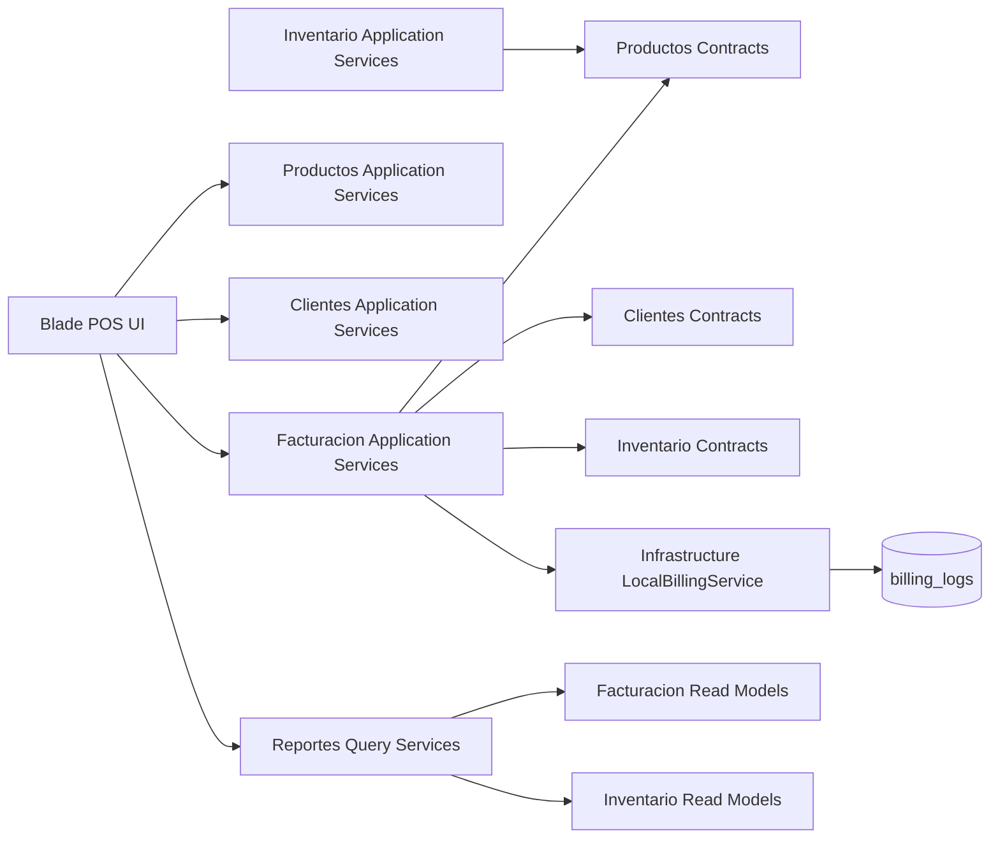

# Arquitectura

## Estilo arquitectónico

La solución seguirá un monolito modular con límites funcionales claros. Cada módulo encapsula su lógica de aplicación y expone únicamente contratos públicos. La aplicación se despliega como una unidad, pero evoluciona como varios bounded contexts internos.

## Diagrama de comunicación modular

## Reglas de comunicación

- `Facturacion` puede consultar productos, clientes e inventario solo mediante contratos.
- `Inventario` puede validar productos mediante contratos del módulo `Productos`.
- `Reportes` consume servicios de lectura, no controladores ni modelos ajenos de forma directa.
- Ningún Blade view accede a lógica de negocio compleja; toda la orquestación vive en services/actions.
- El acceso a casos de uso sensibles debe pasar por policies, gates o middleware de permisos; `super_admin` opera con alcance global y el resto de roles con alcance contextual.

## Capas por módulo

- Presentation: Controllers, Requests, ViewModels, Blade views.
- Application: Services, Actions, DTOs, Contracts de consumo interno.
- Domain: Policies, Rules, Value Objects y excepciones de negocio.
- Infrastructure: Repositories, integrations, providers, cache adapters.

## Facturación local

- `LocalBillingService` implementa `BillingGatewayContract` y:
  - construye el payload del comprobante a partir de los datos locales;
  - genera numeración, CUFE y QR de forma local;
  - registra cada operación en `billing_logs`.
- No existe cliente HTTP externo ni gestión de tokens.

## Transacciones y consistencia

- La venta local se crea en transacción.
- El inventario se confirma sobre la misma transacción lógica local.
- La emisión local actualiza el estado del documento y deja trazabilidad.
- Si la emisión falla luego de persistir localmente, la factura queda en estado recuperable `error`.

## Estrategia de roles

- `super_admin`: administra compañías, sucursales, usuarios, roles, permisos, catálogos globales y monitoreo de integración.
- `admin`: administra operación de una compañía, incluidos productos, clientes, inventario, facturación y reportes.
- `supervisor`: aprueba operaciones sensibles y revisa correcciones.
- `cashier`: opera el POS y acciones restringidas de venta.
- La autorización debe resolverse con RBAC y validaciones de alcance (`company_id`, `branch_id`) además del nombre del rol.

## Seguridad y auditoría (Fase 6)

### Control de acceso

- Middleware `CheckPermission` verifica permisos en cada ruta; `super_admin` opera con bypass intencional documentado.
- `ScopeCompanyBranch` establece atributos de scope por request para filtrado multi-tenant.

### Auditoría de facturación

- Cada operación de emisión/anulación se registra en `billing_logs`.
- No se persisten credenciales ni secretos en la bitácora.
- Configuración de production: `APP_DEBUG=false`, `SESSION_ENCRYPT=true`, `SESSION_SECURE_COOKIE=true`.

### Cobertura de tests

- 72/72 tests pasan (Feature + Unit).
- Cobertura en: Auth, Productos (CRUD, validación, multi-tenant), Inventario (entradas, ajustes, gateway, stock), Facturación (POS, emisión, anulación, verificación) y RBAC (permisos, roles).
